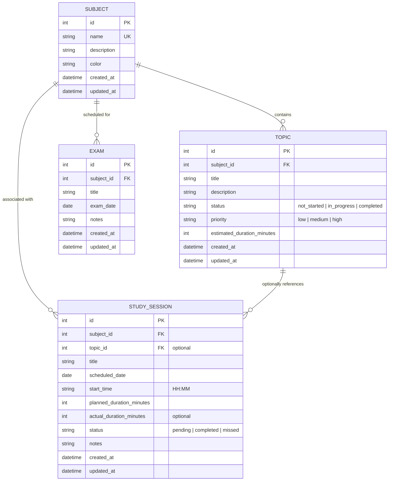

# EDUCATERASTA - Architecture & Technical Specification

## 1. Executive Overview
**EDUCATERASTA** is an AI-powered personalized study planning platform designed to adapt to a learner's pace, syllabus requirements, strengths, and weaknesses.

This document describes the foundational baseline established in **Phase 00** and the core study planning capabilities implemented in **Phase 01**.

---

## 2. Technology Stack

### Frontend
- **Framework**: [React 18](https://react.dev) with [TypeScript](https://www.typescriptlang.org)
- **Bundler & Dev Server**: [Vite 5](https://vitejs.dev)
- **Styling**: [Tailwind CSS 3](https://tailwindcss.com) + PostCSS + Autoprefixer
- **Navigation**: Client-side hash-based routing with browser history support
- **Testing**: [Vitest](https://vitest.dev) + [React Testing Library](https://testing-library.com/docs/react-testing-library/intro/)

### Backend
- **Framework**: [FastAPI](https://fastapi.tiangolo.com) (Python 3.14 compatible)
- **ASGI Server**: [Uvicorn](https://www.uvicorn.org)
- **ORM & Data Layer**: [SQLAlchemy 2.0](https://www.sqlalchemy.org)
- **Schema Validation & Settings**: [Pydantic v2](https://docs.pydantic.dev) & `pydantic-settings`
- **Database**: [SQLite](https://www.sqlite.org) (with `PRAGMA foreign_keys = ON` connection listeners)
- **Migrations**: [Alembic](https://alembic.sqlalchemy.org)
- **Testing**: [Pytest](https://docs.pytest.org) + `pytest-asyncio` + `httpx`

---

## 3. Data Model Architecture (Phase 01)



---

## 4. Business Logic & Calculation Specifications

1. **Subject Progress**:
   - $\text{Progress} = \frac{\text{Completed Topics}}{\text{Total Topics}} \times 100\%$
   - Edge case: Returns $0.0\%$ when $\text{Total Topics} = 0$.
2. **Overall Syllabus Progress**:
   - Calculated across all subjects registered in the platform.
3. **Session Duration Metrics**:
   - Total planned minutes: Sum of $\text{planned\_duration\_minutes}$ across all sessions.
   - Total actual minutes: Sum of $\text{actual\_duration\_minutes}$ for sessions marked as `completed`.
4. **Examination Countdowns**:
   - $\text{Days Remaining} = \text{exam\_date} - \text{today}$.
   - Handled with dynamic flags: `is_today` ($\Delta = 0$), `is_past` ($\Delta < 0$).
5. **Relational Integrity**:
   - Study session topic validation guarantees that any assigned `topic_id` belongs strictly to the assigned `subject_id`.

---

## 5. Directory Layout

```text
educaterasta/
├── .env.example                     # Environment variable blueprint
├── .gitignore                       # Repository exclusion rules
├── README.md                        # Quickstart and operations guide
├── docs/
│   └── architecture.md              # System design and specifications
├── backend/
│   ├── alembic/                     # Database migrations
│   │   └── versions/                # Versioned DDL migration scripts
│   ├── alembic.ini                  # Alembic migration configuration
│   ├── requirements.txt             # Core backend dependencies
│   ├── requirements-dev.txt         # Dev and test dependencies
│   ├── app/
│   │   ├── api/                     # Versioned routing and dependency injection
│   │   │   ├── deps.py              # Reusable dependencies (e.g. DB session)
│   │   │   └── v1/                  # REST API endpoints (subjects, topics, sessions, exams, dashboard, analytics)
│   │   ├── core/
│   │   │   ├── config.py            # Environment-driven settings
│   │   │   └── database.py          # SQLAlchemy engine, session maker, Base, foreign key pragma
│   │   ├── models/                  # Declarative SQLAlchemy models (Subject, Topic, StudySession, Exam)
│   │   ├── schemas/                 # Pydantic request/response schemas
│   │   ├── services/                # Business logic & KPI aggregations (study_service.py)
│   │   └── main.py                  # FastAPI application entrypoint & middleware
│   └── tests/
│       ├── conftest.py              # In-memory SQLite test database fixture & client
│       ├── test_health.py           # Health check test suite
│       └── test_study_planner.py    # Complete CRUD and calculation test suite
└── frontend/
    ├── index.html                   # HTML entry point
    ├── package.json                 # Node manifest and script triggers
    ├── vite.config.ts               # Vite server proxy and Vitest configuration
    ├── tailwind.config.js           # Tailwind utility extensions
    ├── postcss.config.js            # PostCSS plugin registration
    ├── tsconfig.json                # TypeScript composite configuration
    └── src/
        ├── components/              # Modular UI (Sidebar, Modal, StatCard, ProgressBar, Badge, EmptyState)
        ├── pages/                   # SaaS Views (Dashboard, Subjects, Syllabus, Planner, Exams, Analytics, Settings)
        ├── services/                # Centralized typed HTTP API service (api.ts)
        ├── types/                   # TypeScript interfaces and literal unions
        ├── App.tsx                  # Root application component with tab/hash router
        ├── App.test.tsx             # Component testing with Vitest & RTL
        └── main.tsx                 # React DOM mount point
```
